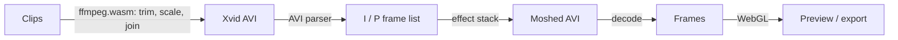

**moshpit** is a datamoshing tool that runs in the browser. It edits the compressed frames of your video directly (removing keyframes, repeating motion frames, borrowing motion from other shots, corrupting bytes), then gives you a timeline and an effect stack to control all of it.

Nothing is uploaded. Decoding and encoding happen locally with [ffmpeg.wasm](https://github.com/ffmpegwasm/ffmpeg.wasm); the picture effects run on WebGL.

**[Open moshpit →](https://furniture3k.github.io/Video-Datamosher/)**&emsp;[](https://github.com/furniture3k/Video-Datamosher/actions/workflows/ci.yml)

<p align="center">
  <br>
  <sub>Two generated clips and the Bloom Explosion preset, exported as a GIF from the app.</sub>
</p>


## Getting started

Open the site, drop in a video (or use **Load example**), choose a preset and press <kbd>Space</kbd>.

To run it locally:

```bash
git clone https://github.com/furniture3k/Video-Datamosher.git
cd Video-Datamosher
npm install
npm run dev            # http://localhost:5173
```

`npm run build` writes a static copy to `dist/` that can be hosted anywhere. The ~30 MB video engine is bundled, so it works offline.

A quick first mosh:

1. Import two clips. Footage with a lot of movement in the second clip works best.
2. **Presets → Cut Transitions.** The keyframe at the cut is removed, so the second clip's motion plays on top of the first clip's picture.
3. Drag and resize the effect bars on the timeline; adjust settings in the panel on the right.
4. **Randomize** rolls a new effect stack. Lock the settings you want to keep and roll again.
5. **Export** to MP4, WebM, GIF, PNG frames, or the raw broken AVI.

## Effects

Bitstream effects change the compressed video itself. The decoder then reconstructs the picture from the damaged instructions, which is where the melting comes from.

| Code | Effect | What it does |
|---|---|---|
| `KEY` | Keyframe Killer | Removes I-frames, so motion after a cut lands on the previous image. All, at cuts only, random, or every Nth. |
| `BLM` | Bloom | Repeats a P-frame so the same motion piles up. First, strongest, every Nth or random frame. |
| `XFR` | Motion Transfer | Takes motion from elsewhere on the timeline and applies it here. |
| `STU` | Stutter Loop | Loops short groups of motion frames, optionally ping-pong. |
| `SHF` | Shuffle | Reorders motion frames inside small windows. |
| `REV` | Reverse Motion | Plays motion frames backwards. |
| `ECH` | Echo | Re-inserts motion from a few frames back. |
| `DRP` | Frame Drop | Deletes every Nth or random frames. |
| `GLT` | Byte Glitch | Corrupts frame data: 11 modes including bit flips, runs, swaps, bit-shifts, inserts and deletes. |

Picture effects run on the decoded frames:

| Code | Effect | What it does |
|---|---|---|
| `WRP` | Vector Warp | Estimates motion on the GPU and lets you bend it: amplify, rotate, swap axes, drift, turbulence, quantise. |
| `CHR` | Chroma Drift | Offsets the colour channels, with jitter and line tearing. |
| `SRT` | Pixel Sort | Sorts runs of pixels by brightness. |

There are 16 presets to start from, and you can save your own.

## Controls

- **Timeline.** Each effect is a bar you can move and resize; it snaps to cuts, the playhead and other effects (hold <kbd>Shift</kbd> to turn snapping off). The output lane shows every frame of the result, coloured by what happened to it.
- **Automation.** Any number or switch can follow a drawn curve or an LFO over the effect's range.
- **Randomize, Nudge, Variations.** Roll a new stack, nudge the current settings, or compare a grid of options side by side. Locked settings and pinned effects are left alone.
- **Seeds.** Every random choice comes from a seed, so a result can always be reproduced.
- **Share codes.** Copy the whole recipe as a short text code and paste it into another project.
- **Encoder settings.** Codec (Xvid, MPEG-2, MPEG-1), quality, keyframe interval, forced keyframes, motion search and more. These change the texture of the mosh as much as the effects do.
- **Audio.** In *follow* mode each frame plays its own slice of sound, so repeats and shuffles are audible. Bitcrush and sample-rate reduction are available.
- **Live.** Real-time warp of a camera, screen or video, with recording back into the project.
- Unlimited undo, autosave (including media) and project files.


## How it works

Most video frames aren't pictures. A codec stores a full image every so often (an I-frame) and, in between, P-frames that only describe how blocks of the previous image move. Remove an I-frame and the decoder keeps moving blocks of the old image around. Repeat a P-frame and the same movement is applied again and again.



1. Clips are trimmed, scaled and encoded to MPEG-4 Part 2 (Xvid) in an AVI container, the format traditionally used for moshing.
2. A TypeScript AVI parser splits the file into frames and reads each frame's header to find its type.
3. The effect stack rewrites that list of compressed frames. It's deterministic for a given seed.
4. The result is written back to an AVI and decoded by FFmpeg, which conceals the errors in its own way.
5. Picture effects run on the GPU, then everything is encoded for export.

## Keyboard

| Key | | Key | |
|---|---|---|---|
| <kbd>Space</kbd> | Play / pause | <kbd>R</kbd> | Randomize |
| <kbd>←</kbd> <kbd>→</kbd> | Step one frame (<kbd>Shift</kbd>: 10) | <kbd>M</kbd> | Nudge |
| <kbd>Home</kbd> <kbd>End</kbd> | Start / end | <kbd>V</kbd> | Variations |
| <kbd>I</kbd> <kbd>O</kbd> | Loop in / out | <kbd>P</kbd> | Presets |
| <kbd>L</kbd> <kbd>X</kbd> | Toggle / clear loop | <kbd>A</kbd> | Add effect |
| <kbd>K</kbd> | Force a keyframe | <kbd>D</kbd> <kbd>Del</kbd> | Duplicate / delete effect |
| <kbd>C</kbd> | Compare with source | <kbd>E</kbd> | Export |
| <kbd>Ctrl</kbd> <kbd>Z</kbd> | Undo (<kbd>Shift</kbd>: redo) | <kbd>?</kbd> | Help |

## Notes

- Browser FFmpeg is slower than a native install. New clips are trimmed to 30 seconds by default, and output is capped at 9,000 frames.
- A moshed AVI plays differently in every player because each one conceals errors differently. The MP4, WebM and GIF exports contain exactly what the preview shows.
- WebM export uses VP8 and Vorbis; the VP9 and Opus encoders in ffmpeg.wasm crash.
- Works in current Chrome, Edge, Firefox and Safari (iOS 15.4 or later).

## Development

```
src/engine/   framework-free TypeScript: AVI reader/writer, frame analysis, effects,
              automation, presets, audio, ffmpeg arguments
src/lib/      browser side: ffmpeg service, renderer, WebGL flow engine, state
src/components, src/dialogs   Svelte 5 interface
```

```bash
npm test                           # engine and integration tests (uses native ffmpeg if present)
npm run check                      # type check
npm run build && npm run test:e2e  # drives the built app in Chromium
```

## Credits

Built on [ffmpeg.wasm](https://github.com/ffmpegwasm/ffmpeg.wasm). Informed by earlier moshing tools including [aviglitch](https://github.com/ucnv/aviglitch), [tomato](https://github.com/itsKaspar/tomato) and [FFglitch](https://ffglitch.org/).
