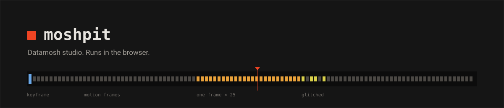
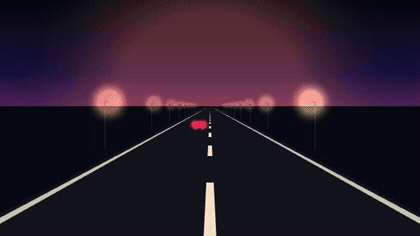
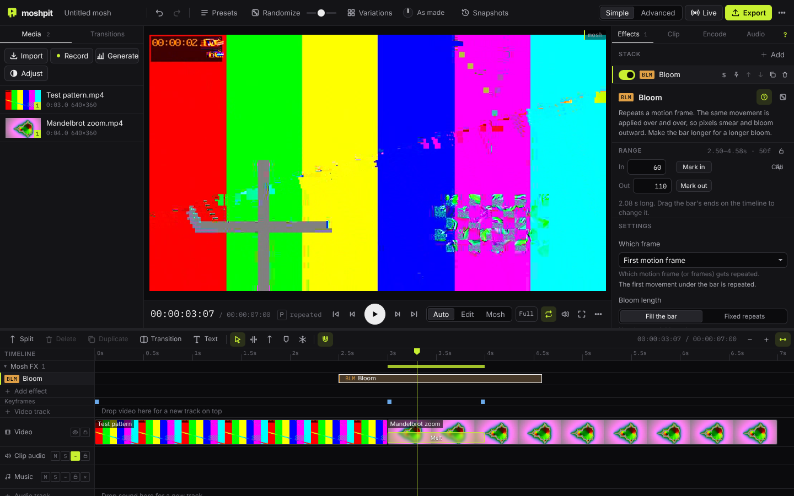
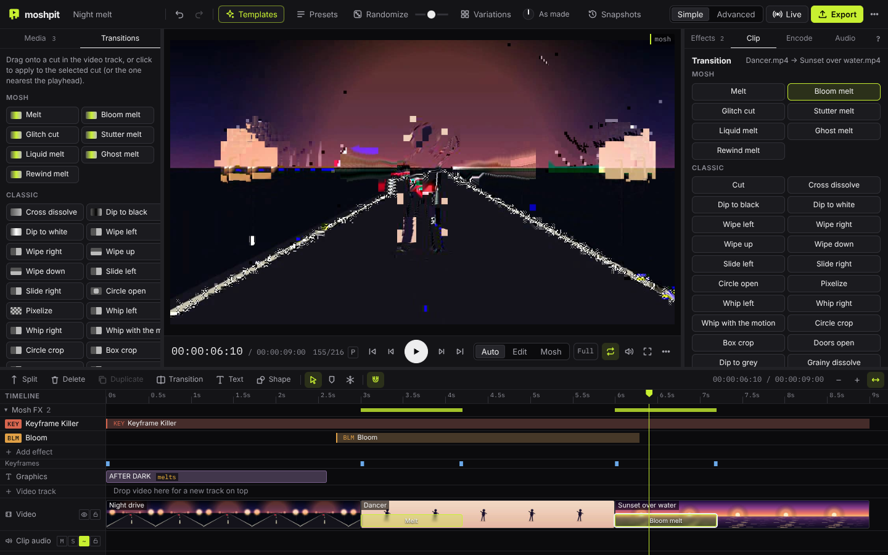
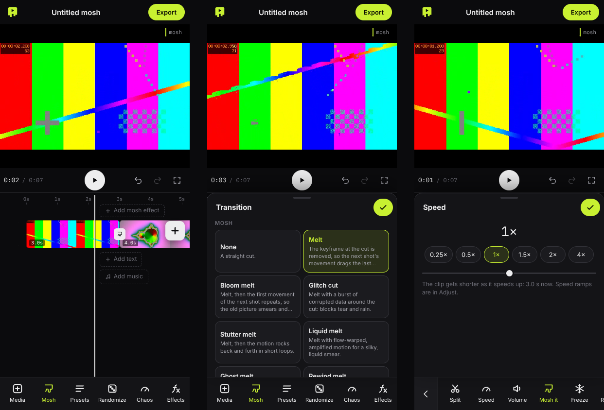
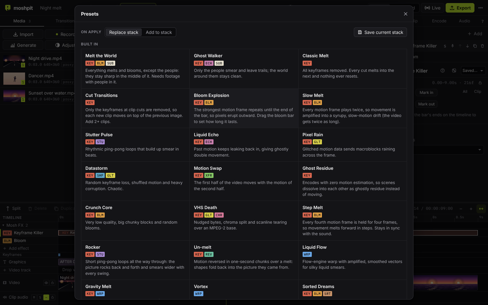
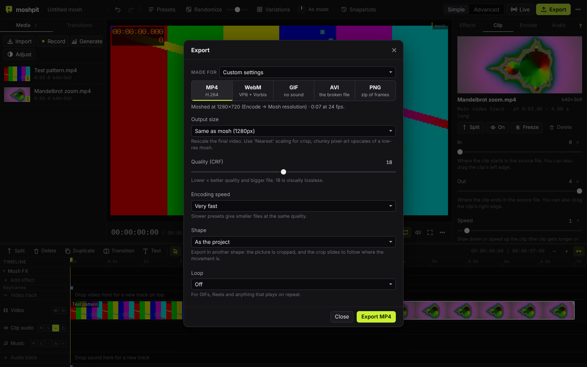
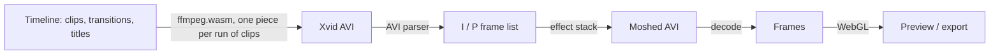

**moshpit** is a video editor with a datamosher built in, running in the browser. Cut your clips, music and titles together on a multi-track timeline, then mosh the result: it edits the compressed frames directly (removing keyframes, repeating motion frames, borrowing motion from other shots, corrupting bytes) with an effect stack and mosh transitions to control all of it. Exports go up to 1080p and beyond.

Nothing is uploaded. Decoding and encoding happen locally with [ffmpeg.wasm](https://github.com/ffmpegwasm/ffmpeg.wasm); the picture effects run on WebGL.

**[Open moshpit →](https://furniture3k.github.io/Video-Datamosher/)**&emsp;[](https://github.com/furniture3k/Video-Datamosher/actions/workflows/ci.yml)

<p align="center">
  <br>
  <sub>Three clips cut together in moshpit with a title, a <b>Melt</b> and a <b>Bloom melt</b> transition, exported as a GIF from the app.</sub>
</p>



## Getting started

Open the site, drop in some videos and a song (or use **Load example**), cut them together on the timeline, put a **Melt** on a cut and press <kbd>Space</kbd>.

To run it locally:

```bash
git clone https://github.com/furniture3k/Video-Datamosher.git
cd Video-Datamosher
npm install
npm run dev            # http://localhost:5173
```

`npm run build` writes a static copy to `dist/` that can be hosted anywhere. The ~30 MB video engine is bundled, so it works offline.

A quick first video:

1. **Import** clips, photos and music. Drag them from the Media panel onto the timeline: footage on the video track, sound on an audio track.
2. Edit like any editor. Drag clips to reorder, drag edges to trim, <kbd>S</kbd> splits at the playhead, right-click a clip for more (detach audio, reverse, duplicate).
3. Click the **+** on a cut (or drag from the **Transitions** tab). **Melt** removes the keyframe at the cut, so the next clip's motion plays on top of the last picture. Classic dissolves, dips, wipes and slides are there too.
4. Add titles with **Text**, fade music with the dots on its clip, and choose per track whether sound stays clean or stutters with the mosh.
5. Layer mosh effects on the **Mosh FX** lanes, or start from **Presets** and **Randomize**.
6. **Export** to MP4 or WebM at up to 4K, GIF, PNG frames, or the raw broken AVI.

## Apps

**Install from the browser (phones, tablets, laptops).** moshpit is an installable web app. Open the site, then:

- **iPhone / iPad:** Safari → Share → **Add to Home Screen**.
- **Android:** Chrome → menu → **Install app** (or **Add to Home screen**).
- **Desktop Chrome / Edge:** the install icon in the address bar.

It opens in its own window with no browser bars, and the whole app, including the video engine, is kept on the device, so it starts and works offline. Updates arrive the next time it's opened online.

**Desktop app (Windows, macOS, Linux).** The same editor in a native window, running a native FFmpeg instead of the browser one. Native FFmpeg uses every CPU core, so preparing and exporting are many times faster, 1440p and 4K are practical, and output can be 30 minutes long (10 minutes in the browser). Exports are saved with the normal Save dialog. Download it from [Releases](https://github.com/furniture3k/Video-Datamosher/releases):

| | File |
|---|---|
| Windows 10/11 | `moshpit_x.y.z_x64-setup.exe` or `.msi` |
| macOS (Apple Silicon) | `moshpit_x.y.z_aarch64.dmg` |
| macOS (Intel) | `moshpit_x.y.z_x64.dmg` |
| Linux | `.AppImage`, `.deb` or `.rpm` |

The builds aren't code-signed yet. On macOS, right-click the app and choose **Open** the first time; on Windows, choose **More info → Run anyway** if SmartScreen asks. See [DESKTOP.md](DESKTOP.md) for building it yourself.

## Effects

Bitstream effects change the compressed video itself. The decoder then reconstructs the picture from the damaged instructions, which is where the melting comes from.

| Code | Effect | What it does |
|---|---|---|
| `KEY` | Keyframe Killer | Removes I-frames, so motion after a cut lands on the previous image. All, at cuts only, random, or every Nth. |
| `BLM` | Bloom | Repeats a P-frame so the same motion piles up. First, strongest, every Nth or random frame; each bloom fills its bar (drag the bar to set the length) or repeats a fixed number of times. |
| `XFR` | Motion Transfer | Takes motion from elsewhere on the timeline, or from a **motion pack** (Drift, Fall, Vortex, Tunnel, Implode, Shake, Ripple, Life: generated on the spot), and applies it here. |
| `STU` | Stutter Loop | Loops short groups of motion frames, optionally ping-pong. |
| `SHF` | Shuffle | Reorders motion frames inside small windows. |
| `REV` | Reverse Motion | Plays motion frames backwards. |
| `ECH` | Echo | Re-inserts motion from a few frames back. |
| `DRP` | Frame Drop | Drops every Nth or random frames. |
| `GLT` | Byte Glitch | Corrupts frame data: 11 modes including bit flips, runs, swaps, bit-shifts, inserts and deletes. |
| `SEQ` | Frame Sequencer | A drum machine for frames: draw a looping pattern of Bloom, Echo, Reverse, Melt and Glitch steps (<kbd>G</kbd> adds one). |
| `DBD` | Databend | Runs an audio effect (echo, reverb, phaser, bitcrush, reverse, amplify) over the compressed frame data. |

Picture effects run on the decoded frames:

| Code | Effect | What it does |
|---|---|---|
| `WRP` | Vector Warp | Estimates motion on the GPU and lets you bend it: amplify, rotate, swap axes, drift, turbulence, quantise. |
| `CHR` | Chroma Drift | Offsets the colour channels, with jitter and line tearing. |
| `SRT` | Pixel Sort | Sorts runs of pixels by brightness. |
| `RAW` | Raw Bend | The Audacity trick on the picture: the RGB values go through echo, reverb, phaser, bitcrush, reverse or amplify. |

Effects that repeat or insert frames (Bloom, Stutter, Echo, Motion Transfer's insert mode, Frame Drop) have a **Timing** setting. **Keep length** (the default) makes the repeats replace the frames after them, so the effect lasts exactly as long as its bar and the picture, the sound and the playhead stay in sync. **Stretch** inserts them instead, so the video gets longer (slow, syrupy melts). Every setting has a description underneath it; the **?** button in the Inspector hides them.

There are 19 presets to start from, and you can save your own.

## Editing

- **Media library.** Video, images, GIFs and sound files (mp3, wav, m4a, flac, ogg). The same media can be used any number of times.
- **Magnetic main track.** Clips butt up against each other, so deleting or trimming one closes the gap. Drag to reorder, drag edges to trim (ripple), split, duplicate, copy and paste. Speed (0.05–16×), reverse, freeze frames and fit per clip.
- **Video tracks on top.** Add Video 2, 3… above the main track for picture-in-picture, overlays and titles made from footage. Clips there are placed freely and composited with opacity and blend modes (screen, add, multiply, difference). Drag a clip between the main track and the tracks above.
- **Transform, colour and fades.** Zoom, position, rotation, flips and crop; brightness, contrast, saturation, gamma and hue; picture fades (drag the dots on a clip's top corners). All of it happens before moshing, so it melts with everything else.
- **Editing tools like an NLE.** Select (<kbd>A</kbd>), Trim (<kbd>T</kbd>: roll a cut, slip a clip's footage) and Blade (<kbd>B</kbd>: click to cut). Box-select with the mouse, ripple delete, turn clips off without removing them, colour labels, locked and hidden tracks, markers, In / Out marks, and Insert / Overwrite / Place on top / Append from the media panel (<kbd>F9</kbd> <kbd>F10</kbd> <kbd>F12</kbd>).
- **Playback like an NLE.** <kbd>J</kbd> <kbd>K</kbd> <kbd>L</kbd> shuttle (backwards too, up to 16×), loop the In–Out range, jump between edit points and markers, and type a timecode to go straight there. The playhead and the picture always match: the mosh keeps the timeline's timing.
- **Transitions.** Mosh transitions (Melt, Bloom melt, Glitch cut, Stutter melt, Liquid melt, Ghost melt, Rewind melt) and classic ones (cross dissolve, dip to black or white, wipes, slides, circle, pixelize). Drag a transition's band to change its length. Mosh transitions last exactly that long, then a fresh keyframe brings the next shot back clean (turn **Resolve at the end** off to let the melt run on).
- **Audio tracks.** As many as you like, with waveforms, volume, fades, mute and solo. Each track either **follows the mosh** (stutters, skips and scrambles with the picture) or stays clean. Video clips' own sound can be muted or detached to a track.
- **Titles.** Text with font, colour, position, shadow, box and fades. Titles sit clean on top or **melt with the video**.
- **Instant preview.** The player shows your cut immediately, straight from the source files, and switches to the rendered mosh when it's ready (or pick **Edit** / **Mosh** yourself). Only the clips you change are re-prepared.
- **Effects stay on their footage.** Moving, trimming, splitting or deleting clips keeps mosh effects, forced keyframes and Motion Transfer sources on the same shots.
- **Recording.** Record from your camera (front or back) or screen straight onto the timeline.
- Snapping (<kbd>N</kbd>, or hold <kbd>Shift</kbd> while dragging), zoom (<kbd>Ctrl</kbd>+wheel, <kbd>+</kbd> <kbd>−</kbd>), resizable timeline, right-click menu on clips.



## On your phone

The same app works on phones and tablets. The player stays at the top, and a tab bar switches between the **Timeline**, **Media** and **Inspector** panels.

- **Swipe** the timeline to scroll, **tap** to move the playhead or select a clip.
- **Press and hold** a clip or effect bar to drag it; **hold and let go** for the clip menu (split, duplicate, reverse, delete).
- Drag a clip's edges to trim it. Use the **+** next to a media item to add it to the timeline.
- **Record** uses the phone's camera, with a button to flip between front and back.



## Controls

- **Effect lanes.** Each mosh effect is a bar you can move and resize; it snaps to cuts, the playhead and other effects. The output lane shows every frame of the result, coloured by what happened to it.
- **Automation.** Any number or switch can follow a drawn curve, an LFO, or **the music**: the bass, mids, highs, loudness, every hit or every beat, with attack, release and a threshold. A glitch can hit harder on the kick drum and a warp swell with the chorus.
- **On the beat.** Bloom, Stutter Loop, Frame Drop and Byte Glitch can fire on every beat, every bar or every hit of the music (and every Nth one). moshpit finds the tempo, the beats and the first beat of each bar itself.
- **Beat grid.** The Audio tab shows the BPM and can draw the beats on the ruler (bars taller); clips, marks and effect bars snap to them.
- **Auto-edit to the beat.** Pick clips and a song and moshpit cuts them on every Nth beat or bar, with melts on the bars and blooms where the music drops.
- **Randomize, Nudge, Variations.** Roll a new stack, nudge the current settings, or compare a grid of options side by side. Locked settings and pinned effects are left alone.
- **Breeding.** In Variations, tick the ones you like and **Breed** them: the children mix their parents' effects and settings. Keep going for as many generations as you like, and step **Back** to an earlier one.
- **Chaos dial.** One knob in the top bar pushes every effect calmer or wilder without touching your settings: 0 % is calm, 100 % is as you made it, 200 % is destroyed. Drag it, scroll it, or press <kbd>Q</kbd> / <kbd>Shift</kbd> <kbd>Q</kbd>.
- **Snapshots.** Save named versions of the project (<kbd>Ctrl</kbd> <kbd>Shift</kbd> <kbd>S</kbd>), restore them, or **Compare** one against the current mosh in the player. One is taken automatically before Randomize, presets, recipes and Variations replace your stack.
- **Seeds.** Every random choice comes from a seed, so a result can always be reproduced.
- **Share codes.** Copy the whole recipe as a short text code and paste it into another project.
- **Recipes travel with your videos.** MP4, WebM, AVI and GIF exports (and PNG zips) carry their recipe. Drop a video made in moshpit into the app and it offers to put that same mosh on your own footage.
- **Encoder settings.** Codec (Xvid, MPEG-2, MPEG-1), quality, keyframe interval, forced keyframes, motion search and more. These change the texture of the mosh as much as the effects do.
- **Generations.** Feedback: the finished mosh is encoded and moshed again up to 8 times, losing a little quality each pass, like a copy of a copy.
- **Bake.** Render the mosh (with its sound) into a clip in the media library, or replace the timeline with it, then cut it, speed it up or mosh it again.
- **Moshed sound.** On tracks that follow the mosh, each frame plays its own slice of sound, so repeats and shuffles are audible. Bitcrush and sample-rate reduction are available.
- **Live.** Real-time warp of a camera, screen or video, with recording back into the project.
- Unlimited undo, autosave (including media) and project files.



## Exporting

MP4 (H.264) and WebM (VP8) with sound, GIF, a zip of PNG frames, or the raw moshed AVI. **Made for** sets everything up for TikTok / Reels / Shorts, the Instagram feed, square posts, YouTube (1080p and 4K), X, Discord (aimed under 10 MB) or chat GIFs. It warns when the video is too long or the wrong shape, and can show the apps' safe zones in the player. The **mosh resolution** (Encode tab) and the **output size** are separate: mosh at 720p for chunky smears and save at 1080p or 4K, or mosh at full resolution. 1080p exports work well in the browser; 1440p and 4K are fine for short videos.



## How it works

Most video frames aren't pictures. A codec stores a full image every so often (an I-frame) and, in between, P-frames that only describe how blocks of the previous image move. Remove an I-frame and the decoder keeps moving blocks of the old image around. Repeat a P-frame and the same movement is applied again and again.



1. The timeline is encoded to MPEG-4 Part 2 (Xvid) in an AVI container, the format traditionally used for moshing. Each run of clips is encoded and cached on its own (every piece starts with a keyframe), so an edit only re-encodes the piece it touches. Blend transitions are done with FFmpeg's `xfade`; mosh transitions become effects at the cut.
2. A TypeScript AVI parser splits the file into frames and reads each frame's header to find its type.
3. The effect stack rewrites that list of compressed frames. It's deterministic for a given seed.
4. The result is written back to an AVI and decoded by FFmpeg, which conceals the errors in its own way.
5. Picture effects run on the GPU, then everything is encoded for export.

## Keyboard

| Key | | Key | |
|---|---|---|---|
| <kbd>Space</kbd> | Play / pause | <kbd>J</kbd> <kbd>K</kbd> <kbd>L</kbd> | Backwards / stop / forwards (again: faster) |
| <kbd>←</kbd> <kbd>→</kbd> | Step a frame (<kbd>Shift</kbd>: a second) | <kbd>↑</kbd> <kbd>↓</kbd> | Previous / next edit (<kbd>Shift</kbd>: marker) |
| <kbd>A</kbd> <kbd>T</kbd> <kbd>B</kbd> | Select / Trim / Blade tool | <kbd>S</kbd> / <kbd>Ctrl</kbd> <kbd>B</kbd> | Split at playhead |
| <kbd>Del</kbd> | Delete (<kbd>Shift</kbd>: ripple delete) | <kbd>D</kbd> | Turn clips off / on |
| <kbd>Ctrl</kbd> <kbd>C</kbd> <kbd>V</kbd> <kbd>X</kbd> <kbd>D</kbd> | Copy / paste / cut / duplicate | <kbd>,</kbd> <kbd>.</kbd> | Nudge clips a frame |
| <kbd>I</kbd> <kbd>O</kbd> <kbd>X</kbd> | Mark In / Out / clip | <kbd>Alt</kbd> <kbd>X</kbd> | Clear In and Out |
| <kbd>/</kbd> | Loop on / off | <kbd>M</kbd> | Marker |
| <kbd>F9</kbd> <kbd>F10</kbd> | Insert / overwrite picked media | <kbd>F12</kbd> (<kbd>Shift</kbd>) | Place on top (append) |
| <kbd>Shift</kbd> <kbd>R</kbd> | Freeze frame | <kbd>Ctrl</kbd> <kbd>T</kbd> / <kbd>Alt</kbd> <kbd>T</kbd> | Melt / dissolve at nearest cut |
| <kbd>N</kbd> | Snapping | <kbd>+</kbd> <kbd>−</kbd> <kbd>Shift</kbd> <kbd>Z</kbd> | Zoom / fit |
| <kbd>Shift</kbd> <kbd>K</kbd> | Force a keyframe | <kbd>Shift</kbd> <kbd>A</kbd> | Add effect |
| <kbd>R</kbd> / <kbd>U</kbd> | Randomize / nudge settings | <kbd>V</kbd> / <kbd>P</kbd> | Variations / presets |
| <kbd>Q</kbd> / <kbd>Shift</kbd> <kbd>Q</kbd> | Chaos dial wilder / calmer | <kbd>Ctrl</kbd> <kbd>Shift</kbd> <kbd>S</kbd> | Save a snapshot |
| <kbd>G</kbd> | Add a Frame Sequencer | | |
| <kbd>C</kbd> | Compare with source | <kbd>E</kbd> | Export |
| <kbd>Ctrl</kbd> <kbd>Z</kbd> | Undo (<kbd>Shift</kbd>: redo) | <kbd>?</kbd> | Help |

## Notes

- Browser FFmpeg is single-threaded and slower than a native install. Clips import at full length; the output is capped at 14,400 frames (10 minutes at 24 fps) in the browser and 43,200 frames (30 minutes at 24 fps) in the desktop app. 1080p export works well; 1440p and 4K work for short videos but take a while. Large files are read in place rather than copied into memory, and preview copies are made in the background.
- The [desktop app](#apps) uses native FFmpeg and doesn't have these limits in practice: it's the better choice for 4K and long videos.
- A moshed AVI plays differently in every player because each one conceals errors differently. The MP4, WebM and GIF exports contain exactly what the preview shows.
- WebM export uses VP8 and Vorbis; the VP9 and Opus encoders in ffmpeg.wasm crash.
- Works in current Chrome, Edge, Firefox and Safari (iOS 15.4 or later), on desktop and on phones. Dragging media from the library needs a mouse; on touch screens use the **+** button.

## Development

```
src/engine/   framework-free TypeScript: timeline model and edit operations, AVI reader/writer,
              frame analysis, effects, automation, presets, audio, ffmpeg arguments
src/lib/      browser side: ffmpeg service, renderer, live edit preview, WebGL flow engine, state
src/components, src/dialogs   Svelte 5 interface
```

```bash
npm test                           # engine and integration tests (uses native ffmpeg if present)
npm run check                      # type check
npm run build && npm run test:e2e  # drives the built app in Chromium
```

Desktop app ([Tauri 2](https://tauri.app); needs [Rust](https://rustup.rs) and, on Linux, the [WebKitGTK packages](https://tauri.app/start/prerequisites/)):

```bash
npm run desktop          # dev window with hot reload (uses the ffmpeg on your PATH, or downloads one)
npm run desktop:build    # installer for this machine in src-tauri/target/release/bundle/
```

Pushing a `v*` tag (or running the **Desktop app** workflow with **release** ticked) builds the Windows, macOS and Linux installers in GitHub Actions and publishes them as a release.

## License

moshpit is free software: you can redistribute it and/or modify it under the terms of the
[GNU General Public License v3.0 or later](LICENSE). It builds on FFmpeg and other open-source
software; see [THIRD-PARTY-NOTICES.md](THIRD-PARTY-NOTICES.md). Contributions are welcome: see
[CONTRIBUTING.md](CONTRIBUTING.md).

## Credits

Built on [ffmpeg.wasm](https://github.com/ffmpegwasm/ffmpeg.wasm). Informed by earlier moshing tools including [aviglitch](https://github.com/ucnv/aviglitch), [tomato](https://github.com/itsKaspar/tomato) and [FFglitch](https://ffglitch.org/).
