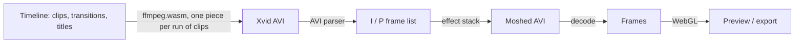

**moshpit** is a video editor with a datamosher built in, running in the browser. Cut your clips, music and titles together on a multi-track timeline, then mosh the result: it edits the compressed frames directly (removing keyframes, repeating motion frames, borrowing motion from other shots, corrupting bytes) with an effect stack and mosh transitions to control all of it. Exports go up to 1080p and beyond.

Nothing is uploaded. Decoding and encoding happen locally with [ffmpeg.wasm](https://github.com/ffmpegwasm/ffmpeg.wasm); the picture effects run on WebGL.

**[Open moshpit →](https://furniture3k.github.io/Video-Datamosher/app/)**&emsp;[Website](https://furniture3k.github.io/Video-Datamosher/) · [Docs](https://furniture3k.github.io/Video-Datamosher/docs/)&emsp;[](https://github.com/furniture3k/Video-Datamosher/actions/workflows/ci.yml)

<p align="center">
  <br>
  <sub>Three clips cut together in moshpit with a title, a <b>Melt</b> and a <b>Bloom melt</b> transition, exported as a GIF from the app.</sub>
</p>


## Getting started

Open the site and you're on the home screen: start a **New project**, import some clips, or start from a **template** (pick your clips and the mosh is set up for you) or an **example** (generated footage, nothing to import). Clips dropped into an empty project are melted straight away so there's something to see; cut them together on the timeline, change the mosh, and press <kbd>Space</kbd>.

Every project is saved on this device by itself and listed on the home screen with a picture of where you left off; the logo takes you back there.

To run it locally:

```bash
git clone https://github.com/furniture3k/Video-Datamosher.git
cd Video-Datamosher
npm install
npm run dev            # http://localhost:5173
```

`npm run build` writes a static copy to `dist/` that can be hosted anywhere: the website at the root (`index.html`, `docs/`) and the editor in `app/`. The ~30 MB video engine is bundled, so it works offline. The dev server serves both too: the website at http://localhost:5173 and the editor at http://localhost:5173/app/.

The quickest start: under **Make a video like this**, pick a look (**Behind the subject**, **Kinetic lyrics**, **Pop-up collage**, **Tour poster** or **Red notes**), choose your clips and a song, type your words, and the titles, cut-outs, tracked marks and timing are made for you. **Templates** in the editor does the same for clips already on the timeline, and one Undo takes it off.

A quick first video by hand:

1. **Import** clips, photos and music. Drag them from the Media panel onto the timeline: footage on the video track, sound on an audio track.
2. Edit like any editor. Drag clips to reorder, drag edges to trim, <kbd>S</kbd> splits at the playhead, right-click a clip for more (detach audio, reverse, duplicate).
3. Click the **+** on a cut (or drag from the **Transitions** tab). **Melt** removes the keyframe at the cut, so the next clip's motion plays on top of the last picture. Classic dissolves, dips, wipes and slides are there too.
4. Add titles with **Text**, fade music with the dots on its clip, and choose per track whether sound stays clean or stutters with the mosh.
5. Layer mosh effects on the **Mosh FX** lanes, or start from **Presets** and **Randomize**.
6. **Export** to MP4 or WebM at up to 4K, GIF, PNG frames, or the raw broken AVI.

## Apps

**Install from the browser (phones, tablets, laptops).** moshpit is an installable web app. Open the site, then:

- **iPhone / iPad:** Safari → Share → **Add to Home Screen**.
- **Android:** Chrome → menu → **Install app** (or **Add to Home screen**).
- **Desktop Chrome / Edge:** the install icon in the address bar.

It opens in its own window with no browser bars, and the whole app, including the video engine, is kept on the device, so it starts and works offline. Updates arrive the next time it's opened online.

Installed, it also works with the rest of the system:

- **Open with moshpit.** In Chrome and Edge, videos, GIFs and sound files get moshpit in their **Open with** menu.
- **Share to moshpit.** On Android, share a video from the gallery or another app straight into moshpit. The export dialog has **Share…** on phones and tablets.
- **Save dialog.** In Chrome and Edge, **Save project** asks where to put the file and <kbd>Ctrl</kbd> <kbd>S</kbd> saves to the same file again.

**Desktop app (Windows, macOS, Linux).** The same editor in a native window, running a native FFmpeg instead of the browser one. Native FFmpeg uses every CPU core, so preparing and exporting are many times faster, 1440p and 4K are practical, and output can be 30 minutes long (10 minutes in the browser). Exports are saved with the normal Save dialog. Videos opened with the desktop app (Open with, or dropped on its icon) go into the open project. Download it from [Releases](https://github.com/furniture3k/Video-Datamosher/releases):

| | File |
|---|---|
| Windows 10/11 | `moshpit_x.y.z_x64-setup.exe` or `.msi` |
| macOS (Apple Silicon) | `moshpit_x.y.z_aarch64.dmg` |
| macOS (Intel) | `moshpit_x.y.z_x64.dmg` |
| Linux | `.AppImage`, `.deb` or `.rpm` |

The builds aren't code-signed yet. On macOS, right-click the app and choose **Open** the first time; on Windows, choose **More info → Run anyway** if SmartScreen asks. See [DESKTOP.md](DESKTOP.md) for building it yourself.

**Android app (experimental).** Each release also has `moshpit-android-arm64.apk`: the editor as an Android app, with the browser's video engine, saving exports to Downloads. It hasn't been tried on many phones yet, so the installable web app (above) is still the safer choice on Android.

## Effects

Bitstream effects change the compressed video itself. The decoder then reconstructs the picture from the damaged instructions, which is where the melting comes from.

| Code | Effect | What it does |
|---|---|---|
| `KEY` | Keyframe Killer | Removes I-frames, so motion after a cut lands on the previous image. All, at cuts only, random, or every Nth. |
| `BLM` | Bloom | Repeats a P-frame so the same motion piles up. First, strongest, every Nth or random frame; each bloom fills its bar (drag the bar to set the length) or repeats a fixed number of times. |
| `XFR` | Motion Transfer | Takes motion from elsewhere on the timeline, or from a **motion pack** (Drift, Fall, Vortex, Tunnel, Implode, Shake, Ripple, Life: generated on the spot), and applies it here. |
| `STU` | Stutter Loop | Loops short groups of motion frames, optionally ping-pong. |
| `SHF` | Shuffle | Reorders motion frames inside small windows. |
| `REV` | Reverse Motion | Plays motion frames backwards. |
| `ECH` | Echo | Re-inserts motion from a few frames back. |
| `DRP` | Frame Drop | Drops every Nth or random frames. |
| `GLT` | Byte Glitch | Corrupts frame data: 11 modes including bit flips, runs, swaps, bit-shifts, inserts and deletes. |
| `SEQ` | Frame Sequencer | A drum machine for frames: draw a looping pattern of Bloom, Echo, Reverse, Melt and Glitch steps (<kbd>G</kbd> adds one). |
| `DBD` | Databend | Runs an audio effect (echo, reverb, phaser, bitcrush, reverse, amplify) over the compressed frame data. |
| `MVX` | Vector Edit | Rewrites the motion vectors inside the compressed frames: amplify, turn, swap, drift, jitter, quantise, or paint them with the brush (Xvid codec). |
| `SCR` | Script | An effect you write in JavaScript: the frames under the bar in any order, repeated, left out or damaged. Runs in a sandbox (no network, no access to your files, a time limit); code from someone else's recipe asks before it runs. |

Picture effects run on the decoded frames:

| Code | Effect | What it does |
|---|---|---|
| `WRP` | Vector Warp | Estimates motion on the GPU and lets you bend it: amplify, rotate, swap axes, drift, turbulence, quantise. |
| `CHR` | Chroma Drift | Offsets the colour channels, with jitter and line tearing. |
| `SRT` | Pixel Sort | Sorts runs of pixels by brightness. |
| `RAW` | Raw Bend | The Audacity trick on the picture: the RGB values go through echo, reverb, phaser, bitcrush, reverse or amplify. |
| `PNT` | Flow Paint | Paint on the player where the picture should flow (push, swirl, pinch, bulge) and it smears along the strokes. |
| `VHS` | VHS | Wobbling lines, a rolling tracking band, colour bleeding to the right and tape noise. |
| `CRT` | CRT | Curved glass, scanlines, red-green-blue stripes, glow and dark corners. |
| `GRN` | Film Grain | Grain that dances every frame, strongest in the midtones, and an optional faded-print look. |
| `PST` | Posterise | A few levels per colour with an ordered or noise dither, and bigger pixels. |
| `1BT` | 1-bit | Every pixel ink or paper (black, red, blue, lime, plum, or white on black), with an optional dither. |
| `HTN` | Halftone | Newspaper or pop-art dots on a turned grid, bigger where it's darker. |
| `LIN` | Line Art | Only the edges: ink on paper, light on black, or lines over the picture. |
| `GLW` | Glow | Bright parts bloom; halation tints it red like film. |
| `VIG` | Vignette | Dark (or white) corners. |
| `LKS` | Light Leak | Warm light drifting in from the edges. |
| `GTE` | Gate Weave | Projector jitter, flicker and dust. |
| `DV` | DV Tape | A 2000s camcorder: blocky colour, over-sharp edges, interlaced lines. |
| `TRL` | Light Trails | Bright things leave fading trails, like a long exposure. |
| `STP` | Step Print | Each picture held for a few frames (also per clip: **Step print** in the Inspector). |
| `SUB` | Subject Guard | Keeps people (found by a small on-device model), a tracked object, the bright or dark parts, or a colour clean while everything else moshes. Or the reverse. Or follows a **Mosh Map**: a gradient (automate it to sweep), a map you paint on the player, a picture or video, or the depth of the scene (an on-device model). |

Effects that repeat or insert frames (Bloom, Stutter, Echo, Motion Transfer's insert mode, Frame Drop) have a **Timing** setting. **Keep length** (the default) makes the repeats replace the frames after them, so the effect lasts exactly as long as its bar and the picture, the sound and the playhead stay in sync. **Stretch** inserts them instead, so the video gets longer (slow, syrupy melts). Every setting has a description underneath it; the **?** button in the Inspector hides them.

**Which effect do I want?** The **Add effect** picker groups them by what you'll see, describes each one in plain words and draws a little strip of frames showing what it does to the video (which frames get repeated, moved, removed or damaged). In **Simple** mode it shows the nine that look the most different from each other; **Show all effects** (or searching) lists the rest. Bloom, Echo, Stutter, Shuffle and Reverse all rework the same motion frames, so on calm footage they can look alike: they come apart on footage with strong, one-direction movement, and on the beat.

There are 21 presets to start from, and you can save your own. **⋯ → Save recipe file** keeps a mosh as a `.moshrecipe` file for other videos, and **⋯ → Batch** puts it on many videos at once and exports them all in the background.

## Editing

- **Media library.** Video, images, GIFs and sound files (mp3, wav, m4a, flac, ogg). The same media can be used any number of times.
- **Magnetic main track.** Clips butt up against each other, so deleting or trimming one closes the gap. Drag to reorder, drag edges to trim (ripple), split, duplicate, copy and paste. Speed (0.05–16×), reverse, freeze frames and fit per clip.
- **Video tracks on top.** Add Video 2, 3… above the main track for picture-in-picture, overlays and titles made from footage. Clips there are placed freely and composited with opacity and blend modes (screen, add, multiply, difference, overlay, soft and hard light, lighten, darken, colour dodge and burn, exclusion), and keyed by a colour (green screen) or by brightness (art shot on black or white). Drag a clip between the main track and the tracks above.
- **Handles on the player.** Click a title or a clip on a track above to pick it right on the picture: drag to move it (it snaps to the middle and to the other things on screen; <kbd>Alt</kbd> for none), drag a corner to scale it, the round handle to turn it (<kbd>Shift</kbd>: 15° steps). A main-track clip gets handles once it's selected on the timeline. On a phone, two fingers pinch and twist. Double-click (or double-tap) a title to type into it. Keyframed settings get a key at the playhead.
- **Transform, colour and fades.** Zoom, position, rotation, flips and crop; brightness, contrast, saturation, gamma and hue; picture fades (drag the dots on a clip's top corners). All of it happens before moshing, so it melts with everything else.
- **Keyframes.** Position, zoom, rotation and opacity can be animated: press ◆ next to a setting to add a keyframe at the playhead, move the playhead and change the value. Keys show as diamonds on the clip; ◀◆ ◆▶ jump between them.
- **Speed ramps.** Speed up, slow down, slow-mo in the middle, rush in the middle or montage bursts, between a Slow and a Fast speed; the clip's length follows and its sound stretches with it.
- **Chroma key.** Green or blue screen on the tracks above: pick the colour with the eyedropper in the player, then set similarity, softness and spill removal.
- **LUTs.** Import `.cube` LUTs (3D or 1D) and apply them to any clip, with an amount.
- **Adjustment layers.** The **Adjust** button in the Media panel puts a layer above the picture that re-colours everything below it while it's on screen (colour, LUT, opacity, fades).
- **Compound clips.** Right-click clips on the main track → **Make compound clip** folds them into one clip with its own timeline. Double-click it to edit inside, **Close compound** to come back. **Mosh inside** renders the compound's own mosh into it, so you can melt a melt.
- **Scopes.** Waveform, RGB parade, vectorscope and histogram over the player (<kbd>Shift</kbd> <kbd>S</kbd>).
- **Cut out a subject.** In the Clip tab, **Cut out a subject**, then tap the thing on the player (tap more to add parts; long-press, right-click or Alt-click to leave something out, tap a dot to take it away). A live mask shows, and **Cut out through clip** follows it through the whole clip (a cancellable job with progress), keeping a matte with the footage. The quick model runs a 10 second clip in a few seconds; the precise one is much slower. Then give any title or shape a **Depth**: *Behind the subject* (it shows between the subject and the background) or *Only on the subject*; or add a **subject effect**: recolour it solid, outline it, glow, echo it, blur or darken everything else. **Right-click** the picture for **Cut out**, **Recolour** and **Text behind**. The models download on first use and stay on your device. **Make sticker** freezes the subject at the playhead into a cropped picture with see-through edges in the media. A clip on a track above can go **behind the subject** too (its Depth), **Subject Guard** can keep the cut-out clean while the rest moshes, and **Blur faces** or **Pixelate faces** follow every face that Find faces found. A slim strip above the player lists what is behind and in front of the subject: click to pick, drag a chip onto another (or use its arrows) to change which is drawn over which.
- **Script, reveals and groups.** **Script** (palette, or the phone's tools): write lines or words and they become titles, one after another or on the beats, and stay linked to the text: edit the words, add or delete a line and the titles follow, keeping the looks you gave them. Select several titles or shapes and **Reveal one per beat** to bring them in one at a time (¼, ½, 1 or 2 beats apart), or **Group** them so they move, copy and delete together (a mark's box, arrow and label are a group already). **Randomize the titles, shapes and canvas** rolls fonts, colours, entrances, places and timing on the beat, and Variations (with *Titles & graphics* ticked) can vary and breed them like the mosh.
- **Pin to the scene.** In the Clip tab, **Track a surface** (a screen, a wall, a sign, a poster), then drag four corners onto it on the player and press **Track it**: moshpit follows it forwards and backwards as it moves, turns and leans, even through moments where part of it is covered. Then **Title on it**, or pin any title or shape to it (**Pin to a surface** in its settings; select several to pin them together), or play a clip from a track above on it with **Clip on it**: its picture is carried to the surface's corners, cropped to its shape. Right-click the picture and **Pin here** to do the first one from there. Pinned things burn into the mosh too. **Curve** bends a title into an arch or a smile, and **Perspective** leans any title or shape back or to the side.
- **One pin for everything tracked.** A title's or shape's **Pin** control lists every tracked object, face and surface in the project. Pick one and the layer moves with it from where it is now (a surface also turns and leans it). **Pin again here** pins it afresh from the playhead and **Unpin** lets go.
- **Hits on the beat.** **Zoom punch** and **Shake** (Clip tab › On the beat) jump the picture in or knock it sideways on every beat or bar, then ease it back: keyframes you can change after.
- **Beats everywhere.** When the music has a beat, the Start and Duration of titles and shapes have a unit button: press it to type them in beats instead of seconds (it follows tempo changes). **Start on the beat** moves a layer onto the nearest beat, particles can **Burst on the beats**, and **Flash a colour on every beat** (palette) puts a few frames of white on each one.
- **More cuts and looks.** New transitions: *Whip with the motion* (it goes the way a tracked object or keyframed move is going), *Circle crop*, *Box crop*, *Doors open*, *Dip to grey* and *Grainy dissolve*. Halftone can be a *Lines* screen and print in *Two colours*. Step print has **Same for the whole track**. The Flipbook can go **behind the subject**. The shape picker has tape, torn paper, a flower, an asterisk and a squiggle for scrapbook pages.
- **Steal this edit.** On the home screen, **Steal this edit** and pick a video you like. moshpit measures how it cuts (against its own beat), how long its shots are, its real frame rate, its colours and grade, any bars or card round the picture and how much text it has. Then it cuts your clips the same way (on the beats of your music, if it cut on the beat), steps the frame rate, adds the card and puts the colours on as a look. It all happens on your device.
- **Type and shapes.** Titles take a gradient fill, a different look on a single line or word, and glow, a drop shadow or an outer stroke (so do shapes). Shapes now include polygons and a leader line with a square at each end, and **Callout** makes a box, a leader line and a label together. Shapes and stickers have style kits like titles do.
- **Collage and fake screens.** In the Clip tab a clip can be a **card** (polaroid, white card or tape-on, with a caption), sit in an animated **mask** (circle, rectangle, triangle, star or heart that can grow), and **pop in** on the next beat. **Swap places on the beat** trades split-screen cells on every beat. The Canvas tab has a **Music player** and a **Chat bubble** mockup, and **Zoom into the screen**, a camera move in on the picture until it fills the frame. The shape picker (and the palette) has a **Click ripple**, **Selected text with a menu** and a **Notification** for fake phone UI.
- **Tracking.** In the Clip tab, **Track an object**, then drag a box around it on the player: moshpit follows it forwards and backwards (through short moments where it's hidden), and the tracked box shows on the player. A title, a clip on a track above, or a Subject Guard can then follow it.
- **Stabilization.** **Stabilize** measures the camera shake and smooths it out, zooming in just enough to hide the edges.
- **Auto captions.** More → **Auto captions** listens with Whisper, running on your device (downloaded once, nothing uploaded), and adds the words as titles: clean, bold short-video style, word-by-word karaoke, or melting with the mosh. Download them as `.srt` or `.vtt`.
- **Editing tools like an NLE.** Select (<kbd>A</kbd>), Trim (<kbd>T</kbd>: roll a cut, slip a clip's footage) and Blade (<kbd>B</kbd>: click to cut). Box-select with the mouse, ripple delete, turn clips off without removing them, colour labels, locked and hidden tracks, markers, In / Out marks, and Insert / Overwrite / Place on top / Append from the media panel (<kbd>F9</kbd> <kbd>F10</kbd> <kbd>F12</kbd>).
- **Playback like an NLE.** <kbd>J</kbd> <kbd>K</kbd> <kbd>L</kbd> shuttle (backwards too, up to 16×), loop the In–Out range, jump between edit points and markers, and type a timecode to go straight there. The playhead and the picture always match: the mosh keeps the timeline's timing.
- **Transitions.** Mosh transitions (Melt, Bloom melt, Glitch cut, Stutter melt, Liquid melt, Ghost melt, Rewind melt) and classic ones (cross dissolve, dip to black or white, wipes, slides, circle open and close, pixelize, whip pans, zoom through, blur dissolve, clock and diagonal wipes, squeeze). Drag a transition's band to change its length. Mosh transitions last exactly that long, then a fresh keyframe brings the next shot back clean (turn **Resolve at the end** off to let the melt run on).
- **Audio tracks.** As many as you like, with waveforms, volume, fades, mute and solo. Each track either **follows the mosh** (stutters, skips and scrambles with the picture) or stays clean. Video clips' own sound can be muted or detached to a track.
- **Titles.** Text with font, colour, position, shadow, box, fades, letter and line spacing, an outline (or hollow letters), fit to the frame width, an entrance (typewriter, word by word, glitch, slide, pop, slam, stamp, drop) and an exit, strobe, a hand-drawn boil, and copies filling the frame or scrolling like a ticker. Lengths can be set in beats of the music. **Fonts:** add any Google Font (a list picked for these edits: condensed, serif, calligraphy, handwriting, typewriter, pixel, or any family by name) or a font file of your own; it's kept with the project, and Google Fonts are fetched again on another device. Titles sit clean on top or **melt with the video**, also while they animate or follow a tracked object. Each title sits on a graphics row (higher rows are drawn on top): drag one above the rows to start a new row. **Styles** put a whole look on a title in one click (Word slam, Poster, Film lyric, Red notes, Storybook, Glitch caption, Clean), or on every title; save your own, and new titles get the style you used last.
- **Canvas.** Set the picture in like a card on a colour, a gradient or a blurred copy of itself, with round corners, a border, a shadow and room for a caption (Paper card, Polaroid, Blurred, Pastel and Night to start from), or an image of your own behind it. It melts with the mosh; titles and shapes still use the whole frame. **Split screen**: the clips under the playhead side by side, stacked, one big and two small, or in a 2×2 or 3×3 grid, with a gap. **Flipbook** swaps pictures (or bits of clips) on every beat or every few frames, on a new track. **Mockups** play the picture on a generic phone, browser window, app window or laptop. A **stamp trail** makes a title or shape step across the frame on the beat, leaving copies behind.
- **Shapes and marks.** Boxes, rounded boxes, circles, triangles, stars, lines and arrows (bend them into curves), corner marks, underlines, a highlighter, a tunnel of boxes, a mouse cursor, a loading bar that fills, hearts, sparkles and starbursts, emoji stickers, or a line drawn by hand with the pen. Any title or shape can rise, fall or burst as **particles**. **Right-click** (or long-press on a phone) on the picture to put a title, a box, an arrow, a sticker or a moving mark right there. **Find faces** follows every face in a clip so a sticker or label can sit on it. Each has a line colour and width, a fill and a glow, can **draw itself on** like a pen and **wobble** as if drawn again every few frames, and melts with the video like a title. **Mark something moving**: drag a box round it on the player and it's tracked, then boxed, pointed at with an arrow and labelled, and all three follow it.
- **Instant preview.** The player shows your cut immediately, straight from the source files, and switches to the rendered mosh when it's ready (or pick **Edit** / **Mosh** yourself). Only the clips you change are re-prepared.
- **Sharp preview.** The **Full / 1/2 / 1/4** button under the player sets the mosh preview's resolution against your mosh resolution, like an NLE's playback resolution. **Full** looks exactly like the export (block size and all) and is the default in the desktop app; the browser starts at **1/2**, which renders faster. The edit preview draws from your original files at the size the player is on screen, and only switches to the fast preview copies while you scrub.
- **Effects stay on their footage.** Moving, trimming, splitting or deleting clips keeps mosh effects, forced keyframes and Motion Transfer sources on the same shots.
- **Recording.** Record from your camera (front or back) or screen straight onto the timeline.
- Snapping (<kbd>N</kbd>, or hold <kbd>Shift</kbd> while dragging), zoom (<kbd>Ctrl</kbd>+wheel, <kbd>+</kbd> <kbd>−</kbd>), resizable timeline, right-click menu on clips.
- **Feels like an app.** Nothing in the interface can be accidentally highlighted, there's no browser right-click menu, and in the desktop app page zoom, reload and print are switched off.


## On your phone

Phones get their own editor, laid out like the mobile editors you already know rather than a shrunk desktop:

- **A big preview** on top. Tap the picture to play or pause.
- **A timeline with the playhead fixed in the middle.** Swipe to scrub, pinch to zoom. Tap a clip to select it, drag its white handles to trim, press and hold to move it. The small squares on the cuts are transitions: tap one to pick a Melt or a dissolve.
- **Tools along the bottom that follow what you select**: Media, Mosh, Presets, Randomize, Chaos, Text, Music… with nothing selected; Split, Speed, Volume, Mosh it, Freeze, Reverse, Adjust and Delete with a clip selected; Settings, On/Off and Delete with an effect selected.
- **Sheets slide up over the timeline**, so the preview stays in view while you change things.
- **Record** uses the phone's camera, with a button to flip between front and back.


## Controls

- **Effect lanes.** Each mosh effect is a bar you can move and resize; it snaps to cuts, the playhead and other effects. The output lane shows every frame of the result, coloured by what happened to it.
- **Automation.** Any number or switch can follow a drawn curve, an LFO, or **the music**: the bass, mids, highs, loudness, every hit or every beat, with attack, release and a threshold. A glitch can hit harder on the kick drum and a warp swell with the chorus.
- **On the beat.** Bloom, Stutter Loop, Frame Drop and Byte Glitch can fire on every beat, every bar or every hit of the music (and every Nth one). moshpit finds the tempo, the beats and the first beat of each bar itself.
- **Beat grid.** The Audio tab shows the BPM and can draw the beats on the ruler (bars taller), or halves or quarters of a beat; clips, marks and effect bars snap to them.
- **Words on the beat.** Paste a sentence or lyrics and each word (or line) becomes its own title on every beat (or ¼, ½, 2 or 4 beats) or on the cuts, in the style you pick.
- **Auto-edit to the beat.** Pick clips and a song and moshpit cuts them on every Nth beat or bar (or every ½ or ¼ beat), with melts on the bars and blooms where the music drops.
- **Randomize, Nudge, Variations.** Roll a new stack, nudge the current settings, or compare a grid of options side by side. Locked settings and pinned effects are left alone.
- **Breeding.** In Variations, tick the ones you like and **Breed** them: the children mix their parents' effects and settings. Keep going for as many generations as you like, and step **Back** to an earlier one.
- **Chaos dial.** One knob in the top bar pushes every effect calmer or wilder without touching your settings: 0 % is calm, 100 % is as you made it, 200 % is destroyed. Drag it, scroll it, or press <kbd>Q</kbd> / <kbd>Shift</kbd> <kbd>Q</kbd>.
- **Snapshots.** Save named versions of the project (<kbd>Ctrl</kbd> <kbd>Shift</kbd> <kbd>S</kbd>), restore them, or **Compare** one against the current mosh in the player. One is taken automatically before Randomize, presets, recipes and Variations replace your stack.
- **Seeds.** Every random choice comes from a seed, so a result can always be reproduced.
- **Share codes.** Copy the whole recipe as a short text code and paste it into another project.
- **Recipes travel with your videos.** MP4, WebM, AVI and GIF exports (and PNG zips) carry their recipe. Drop a video made in moshpit into the app and it offers to put that same mosh on your own footage.
- **MIDI and OSC.** Right-click any effect setting and move a knob, fader or pad to control it (Chrome and Edge; the desktop app also listens for OSC).
- **Encoder settings.** Codec (Xvid, MPEG-2, MPEG-1, or H.264 as an experiment), quality, keyframe interval, forced keyframes, motion search and more. These change the texture of the mosh as much as the effects do.
- **Generations.** Feedback: the finished mosh is encoded and moshed again up to 8 times, losing a little quality each pass, like a copy of a copy.
- **Bake.** Render the mosh (with its sound) into a clip in the media library, or replace the timeline with it, then cut it, speed it up or mosh it again.
- **Moshed sound.** On tracks that follow the mosh, each frame plays its own slice of sound, so repeats and shuffles are audible. Bitcrush and sample-rate reduction are available.
- **Live.** Real-time warp of a camera, screen or video, with recording back into the project.
- Unlimited undo, autosave (including media) and project files.
- **Storage** (⋯ menu) shows what your media, preview copies and snapshots take, and cleans up what nothing uses. If moshpit closes in the middle of a render (usually out of memory), it starts with auto-render paused instead of crashing again.
- **Report a problem** (⋯ menu) opens a GitHub bug report with the version, browser and the engine's last messages filled in, without your media or file names.


## Exporting

MP4 (H.264) and WebM (VP9 or VP8) with sound, GIF, a zip of PNG frames, or the raw moshed AVI. **Shape** exports another aspect than the project (9:16 from 16:9…) with the crop following the action, and **Loop** makes seamless loops: a crossfade, or a melt where the start grows out of the end picture. **Made for** sets everything up for TikTok / Reels / Shorts (1080×1920, or 2160×3840 4K for Shorts and TikTok), the Instagram feed, square posts, YouTube (1080p and 4K), X, Discord (aimed under 10 MB) or chat GIFs. It warns when the video is too long or the wrong shape, and can show the apps' safe zones in the player. Sizes are named by what they make in the project's shape: on a 9:16 project 1080p is 1080×1920 and 4K is 2160×3840. The **mosh resolution** (Encode tab) and the **output size** are separate: mosh at 720p for chunky smears and save at 1080p or 4K, or mosh at full resolution. 1080p exports work well in the browser; 1440p and 4K are fine for short videos. Where the browser has its own video encoder (WebCodecs), MP4 and WebM are encoded with it, several times faster; **Add to queue** exports in the background while you keep editing.


## How it works

Most video frames aren't pictures. A codec stores a full image every so often (an I-frame) and, in between, P-frames that only describe how blocks of the previous image move. Remove an I-frame and the decoder keeps moving blocks of the old image around. Repeat a P-frame and the same movement is applied again and again.



1. The timeline is encoded to MPEG-4 Part 2 (Xvid) in an AVI container, the format traditionally used for moshing. Each run of clips is encoded and cached on its own (every piece starts with a keyframe), so an edit only re-encodes the piece it touches. Blend transitions are done with FFmpeg's `xfade`; mosh transitions become effects at the cut.
2. A TypeScript AVI parser splits the file into frames and reads each frame's header to find its type.
3. The effect stack rewrites that list of compressed frames. It's deterministic for a given seed.
4. The result is written back to an AVI and decoded by FFmpeg, which conceals the errors in its own way.
5. Picture effects run on the GPU, then everything is encoded for export: by the browser's own encoder (WebCodecs) where it has one, else by FFmpeg.

## Keyboard

<kbd>Ctrl</kbd> <kbd>P</kbd> (<kbd>⌘</kbd> <kbd>P</kbd> on a Mac) finds any command, effect or preset by name. Every shortcut can be changed in **Help**, which also prints a cheat sheet. The defaults:

| Key | | Key | |
|---|---|---|---|
| <kbd>Space</kbd> | Play / pause | <kbd>J</kbd> <kbd>K</kbd> <kbd>L</kbd> | Backwards / stop / forwards (again: faster) |
| <kbd>←</kbd> <kbd>→</kbd> | Step a frame (<kbd>Shift</kbd>: a second) | <kbd>↑</kbd> <kbd>↓</kbd> | Previous / next edit (<kbd>Shift</kbd>: marker) |
| <kbd>A</kbd> <kbd>T</kbd> <kbd>B</kbd> | Select / Trim / Blade tool | <kbd>S</kbd> / <kbd>Ctrl</kbd> <kbd>B</kbd> | Split at playhead |
| <kbd>Del</kbd> | Delete (<kbd>Shift</kbd>: ripple delete) | <kbd>D</kbd> | Turn clips off / on |
| <kbd>Ctrl</kbd> <kbd>C</kbd> <kbd>V</kbd> <kbd>X</kbd> <kbd>D</kbd> | Copy / paste / cut / duplicate | <kbd>,</kbd> <kbd>.</kbd> | Nudge clips a frame |
| <kbd>I</kbd> <kbd>O</kbd> <kbd>X</kbd> | Mark In / Out / clip | <kbd>Alt</kbd> <kbd>X</kbd> | Clear In and Out |
| <kbd>/</kbd> | Loop on / off | <kbd>M</kbd> | Marker |
| <kbd>F9</kbd> <kbd>F10</kbd> | Insert / overwrite picked media | <kbd>F12</kbd> (<kbd>Shift</kbd>) | Place on top (append) |
| <kbd>Shift</kbd> <kbd>R</kbd> | Freeze frame | <kbd>Ctrl</kbd> <kbd>T</kbd> / <kbd>Alt</kbd> <kbd>T</kbd> | Melt / dissolve at nearest cut |
| <kbd>N</kbd> | Snapping | <kbd>+</kbd> <kbd>−</kbd> <kbd>Shift</kbd> <kbd>Z</kbd> | Zoom / fit |
| <kbd>Shift</kbd> <kbd>K</kbd> | Force a keyframe | <kbd>Shift</kbd> <kbd>A</kbd> | Add effect |
| <kbd>R</kbd> / <kbd>U</kbd> | Randomize / nudge settings | <kbd>V</kbd> / <kbd>P</kbd> | Variations / presets |
| <kbd>Q</kbd> / <kbd>Shift</kbd> <kbd>Q</kbd> | Chaos dial wilder / calmer | <kbd>Ctrl</kbd> <kbd>Shift</kbd> <kbd>S</kbd> | Save a snapshot |
| <kbd>G</kbd> | Add a Frame Sequencer | <kbd>Shift</kbd> <kbd>S</kbd> | Scopes |
| <kbd>C</kbd> | Compare with source | <kbd>E</kbd> | Export |
| <kbd>Ctrl</kbd> <kbd>Z</kbd> | Undo (<kbd>Shift</kbd>: redo) | <kbd>?</kbd> | Help |

## Notes

- Browser FFmpeg is slower than a native install. Where the browser allows it (Chrome, Edge, Firefox), it runs on up to 4 threads; exports use the browser's own hardware encoder where there is one. Clips import at full length; the output is capped at 14,400 frames (10 minutes at 24 fps) in the browser and 43,200 frames (30 minutes at 24 fps) in the desktop app. 1080p export works well; 1440p and 4K work for short videos but take a while. Large files are read in place rather than copied into memory, and preview copies are made in the background.
- The [desktop app](#apps) uses native FFmpeg and doesn't have these limits in practice: it's the better choice for 4K and long videos.
- A moshed AVI plays differently in every player because each one conceals errors differently. The MP4, WebM and GIF exports contain exactly what the preview shows.
- WebM export uses VP9 (the browser's own encoder) or VP8 (ffmpeg.wasm's), with Vorbis sound; the VP9 and Opus encoders in ffmpeg.wasm crash.
- Works in current Chrome, Edge, Firefox and Safari (iOS 15.4 or later), on desktop and on phones. Dragging media from the library needs a mouse; on touch screens use the **+** button.

## Development

```
src/engine/   framework-free TypeScript: timeline model and edit operations, AVI reader/writer,
              frame analysis, effects, automation, presets, audio, ffmpeg arguments
src/lib/      browser side: ffmpeg service, renderer, live edit preview, WebGL flow engine, state
src/components, src/dialogs   Svelte 5 interface
```

```bash
npm test                           # engine and integration tests (uses native ffmpeg if present)
npm run check                      # type check
npm run build && npm run test:e2e  # drives the built app in Chromium
```

Desktop app ([Tauri 2](https://tauri.app); needs [Rust](https://rustup.rs) and, on Linux, the [WebKitGTK packages](https://tauri.app/start/prerequisites/)):

```bash
npm run desktop          # dev window with hot reload (uses the ffmpeg on your PATH, or downloads one)
npm run desktop:build    # installer for this machine in src-tauri/target/release/bundle/
```

Pushing a `v*` tag (or running the **Desktop app** workflow with **release** ticked) builds the Windows, macOS and Linux installers in GitHub Actions and publishes them as a release.

## License

moshpit is free software: you can redistribute it and/or modify it under the terms of the
[GNU General Public License v3.0 or later](LICENSE). It builds on FFmpeg and other open-source
software; see [THIRD-PARTY-NOTICES.md](THIRD-PARTY-NOTICES.md). Contributions are welcome: see
[CONTRIBUTING.md](CONTRIBUTING.md).

## Credits

Built on [ffmpeg.wasm](https://github.com/ffmpegwasm/ffmpeg.wasm). Informed by earlier moshing tools including [aviglitch](https://github.com/ucnv/aviglitch), [tomato](https://github.com/itsKaspar/tomato) and [FFglitch](https://ffglitch.org/).
