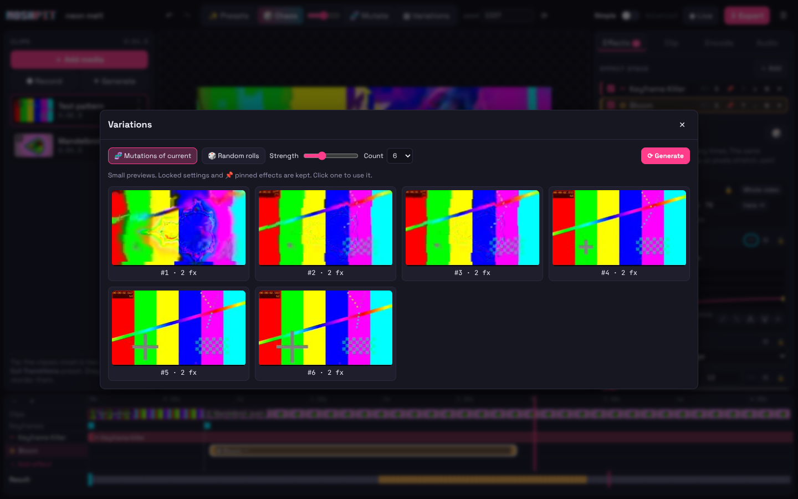
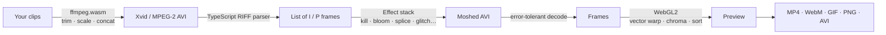

<p align="center">
  
</p>

<p align="center">
  <b>A full datamoshing studio that runs entirely in your browser.</b><br>
  Melt scenes into each other, make pixels bloom, steal motion from one clip and paint it onto another, corrupt the bitstream, bend motion vectors live on your webcam.<br>
  No installs. No uploads. No limits on how weird it gets.
</p>

<p align="center">
  <a href="https://furniture3k.github.io/Video-Datamosher/"><b>▶ Open MOSHPIT</b></a> ·
  <a href="#quick-start">Quick start</a> ·
  <a href="#toolbox">Effects</a> ·
  <a href="#how-it-works">How it works</a> ·
  <a href="#shortcuts">Shortcuts</a>
</p>

<p align="center">
  <a href="https://github.com/furniture3k/Video-Datamosher/actions/workflows/ci.yml"></a>
  
  
  
  
  
</p>

<p align="center">
  <br>
  <sub>Made in MOSHPIT in about ten seconds: two generated clips, the <i>Bloom Explosion</i> preset, exported as a GIF from the app.</sub>
</p>

---

## ✨ Why MOSHPIT?

Most datamosh tools are either a command-line script with two knobs, or a "glitch filter" that only fakes the look. MOSHPIT does it **for real**: it rewrites the compressed video frames themselves, the same way artists did it by hand in Avidemux. Then it wraps that in a studio where **every single part of the process is a setting you can see, change, automate, randomise or lock.**

- 🧪 **Real bitstream moshing.** I-frame removal, P-frame duplication, motion transfer and byte-level corruption on genuine Xvid/MPEG-2/MPEG-1 streams.
- 🌀 **A GPU flow engine** for when you want to *bend* motion: amplify it, rotate it, reverse it, quantise it, add gravity or turbulence.
- 🎛️ **Total control.** 12 effects with 62 parameters, about 30 more encoder, decoder and audio settings, an effect stack, a timeline, and curves or LFOs on any setting.
- 🎲 **Creative autonomy.** Chaos rolls, mutations, a variations grid, locks and pins, reproducible seeds, and shareable recipe codes.
- 🔒 **Private by design.** Everything happens on your machine with WebAssembly and WebGL. Your footage never leaves the tab.
- 📱 **Works anywhere.** Desktop, laptop, tablet or phone. It even works offline once loaded.

<p align="center">
  
</p>

---

<a id="quick-start"></a>

## 🚀 Quick start

### Use it online
Open **https://furniture3k.github.io/Video-Datamosher/**, drop in a video (or press **✦ Generate**), pick a preset, press <kbd>Space</kbd>.

### Run it locally
```bash
git clone https://github.com/furniture3k/Video-Datamosher.git
cd Video-Datamosher
npm install
npm run dev          # → http://localhost:5173
```

### Build a static copy you can host anywhere
```bash
npm run build        # outputs dist/ (the ~30 MB video engine is bundled, no CDN needed)
npm run preview
```

### Your first mosh in 30 seconds
1. **Add two clips**: drag files in, **● Record** your webcam, or **✦ Generate** a fractal.
2. **✨ Presets → Cut Transitions**: the second clip now moves *on top of* the first one's image.
3. **Drag the effect bars** on the timeline, and tweak anything in the right-hand panel.
4. Hit **🎲 Chaos** a few times. Found something good? 🔒 lock it and keep rolling.
5. **⇩ Export** to MP4, WebM, GIF, PNG frames, or the raw broken AVI.

---

<a id="toolbox"></a>

## 🧰 The toolbox

### Bitstream effects (the real thing)
These edit the compressed frames directly. The decoder then faithfully reconstructs the "wrong" picture.

| | Effect | What it does | Highlights |
|---|---|---|---|
| ✂ | **Keyframe Killer** | Deletes I-frames so new motion paints onto the old image: the classic melt | all / only at clip cuts / random chance / every Nth · fill gaps or drop them |
| ✿ | **Bloom** | Repeats a P-frame so the same motion piles up into an explosion | first / strongest / every Nth / random frame · jitter · automatable repeats |
| ⇢ | **Motion Transfer** | Borrows motion from anywhere in the timeline and applies it elsewhere | replace or insert · loops · speed |
| ↻ | **Stutter Loop** | Loops small groups of motion for rhythmic, pulsing smears | group size · loops · interval · ping-pong |
| ⤨ | **Shuffle** | Scrambles motion-frame order in windows | window · amount · keep keyframes |
| ⇆ | **Reverse Motion** | Plays motion backwards, so things un-melt strangely | window size |
| ◎ | **Echo** | Re-injects past motion as ghostly double movement | delay · chance · multi-tap |
| ⌫ | **Frame Drop** | Removes frames for skips and stutters | every Nth / random · motion-only |
| ▦ | **Byte Glitch** | Corrupts the data itself: tearing, colour bleed, macroblock rain | 11 modes (bit flip, nudge, zero, max, runs, copy, swap, bit-shift, insert, delete…) · target I/P · region · header protection |

### Pixel & flow effects
These run on the decoded picture, on the GPU.

| | Effect | What it does |
|---|---|---|
| ➶ | **Vector Warp** | GPU block-matching motion estimation plus a feedback canvas. Amplify, rotate, swap X/Y, drift, turbulence, quantise, threshold, residual and refresh: full manual control over motion vectors. |
| ◐ | **Chroma Drift** | RGB channel split with wobble and scanline tearing |
| ≣ | **Pixel Sort** | Classic brightness-threshold pixel sorting, horizontal or vertical |

### 16 presets to start from
🫠 Classic Melt · 🎬 Cut Transitions · 💥 Bloom Explosion · 🕯 Slow Melt · 💓 Stutter Pulse · 🌊 Liquid Echo · 🌧 Pixel Rain · ⛈ Datastorm · 🔀 Motion Swap · 👻 Ghost Residue · 🧱 Crunch Core · 📼 VHS Death · 💧 Liquid Flow · 🍯 Gravity Melt · 🌀 Vortex · 🌅 Sorted Dreams. You can also save your own.

<p align="center">
  
  
</p>

---

## 🎛️ Creative control

| Feature | Details |
|---|---|
| **Timeline** | Every effect is a bar you can drag and resize. Snaps to cuts, the playhead and other effects (hold <kbd>Shift</kbd> to disable). Includes a keyframe lane and a colour-coded **result strip** showing exactly which frames were duplicated, glitched, moved or transferred. |
| **Automation** | Click 〰 on any numeric or on/off setting: draw a curve (smooth / linear / steps) or use an LFO (sine, triangle, square, saw, random, noise). |
| **🎲 Chaos** | Rolls a fresh random effect stack, with an intensity knob. |
| **🧬 Mutate** | Nudges every unlocked setting a little. |
| **▦ Variations** | Renders a grid of 4–12 mutations or random rolls side by side. Click one to keep it. |
| **🔒 Lock / 📌 Pin** | Lock individual settings, ranges or seeds; pin whole effects so randomisation leaves them alone. |
| **Seeds** | Every random decision is seeded, so the same seed always gives the same mosh. |
| **Mosh codes** | Share a recipe as a short `MOSH:…` string that works on anyone's footage. |
| **Encoder lab** | Codec (Xvid / MPEG-2 / MPEG-1), quality, keyframe interval, scene-cut, forced keyframes (<kbd>K</kbd>), motion search, B-frames, macroblock decision, compare function, 4MV, quarter-pel, trellis. |
| **Decoder lab** | Error-concealment strategy, ignore errors, show all frames. |
| **Audio that moshes too** | In *follow* mode every frame plays its own slice of sound, so blooms stutter and shuffles scramble in sync. Plus bitcrush, sample-rate crush, byte glitch and reversed slices. |
| **A/B compare** | Split wipe, side by side, or original only. |
| **Safety nets** | Unlimited undo/redo, autosave (including your media) in IndexedDB, and project files. |
| **◉ Live Mode** | Real-time flow mosh of your webcam, screen or a video: six quick looks, drag-to-push pixels, drop an image to mosh into, and record straight back into the project. |
| **Export** | MP4 (H.264), WebM (VP8 + Vorbis), GIF (palette, dithering, colours, fps), a ZIP of PNG frames, or the raw moshed AVI. Optional nearest-neighbour upscaling for crisp pixel art. |
| **Friendly** | Simple / Advanced modes, a tooltip on every setting, onboarding, light and dark themes, and a phone layout. |

---

<a id="how-it-works"></a>

## 🧠 How datamoshing works

Video codecs don't store every frame as a picture. They store a full image now and then (an **I-frame**) and in between only **P-frames**: tiny instructions like *"move this 16×16 block 3 px left, then nudge its colour"*.

```
 normal:     [ I ] → [P] → [P] → [P] → [ I ] → [P] → [P]
                 clip A ────────────▶ │ clip B ──────▶

 moshed:     [ I ] → [P] → [P] → [P] → ░░░░░ → [P] → [P]
                 clip A ────────────▶   clip B's motion, applied to clip A's pixels
```

**Delete the keyframe** and the decoder keeps applying the new motion to the *old* picture, so scenes melt into each other. **Repeat a P-frame** and the same motion is applied again and again, so pixels bloom outward.

### MOSHPIT's pipeline



1. Clips are trimmed, scaled and concatenated, then encoded to **MPEG-4 Part 2 (Xvid)** in an AVI. That's the classic moshing format: each frame is a separate chunk, and decoders tolerate broken streams.
2. A TypeScript **RIFF/AVI parser** pulls out every frame and reads its VOP header to learn whether it's an I, P or B frame.
3. Your **effect stack** rewrites that list of compressed frames. It's pure, seeded and deterministic.
4. A new AVI is written and decoded with FFmpeg's error concealment into frame-accurate JPEGs for scrubbing.
5. **Pixel effects** run on the GPU, then everything is encoded for export.

---

<a id="shortcuts"></a>

## ⌨️ Keyboard shortcuts

| Key | Action | Key | Action |
|---|---|---|---|
| <kbd>Space</kbd> | Play / pause | <kbd>R</kbd> | 🎲 Chaos roll |
| <kbd>←</kbd> <kbd>→</kbd> | Step a frame (<kbd>Shift</kbd> = 10) | <kbd>M</kbd> | 🧬 Mutate |
| <kbd>Home</kbd> <kbd>End</kbd> | Jump to start / end | <kbd>V</kbd> | ▦ Variations |
| <kbd>I</kbd> <kbd>O</kbd> | Loop in / out | <kbd>P</kbd> | ✨ Presets |
| <kbd>L</kbd> / <kbd>X</kbd> | Toggle / clear loop | <kbd>A</kbd> | Add effect |
| <kbd>K</kbd> | Force a keyframe here | <kbd>D</kbd> / <kbd>Del</kbd> | Duplicate / delete effect |
| <kbd>C</kbd> | Compare with original | <kbd>E</kbd> | Export |
| <kbd>Enter</kbd> | Render now | <kbd>Ctrl</kbd>+<kbd>Z</kbd> / <kbd>Ctrl</kbd>+<kbd>Shift</kbd>+<kbd>Z</kbd> | Undo / redo |
| <kbd>Ctrl</kbd>+<kbd>S</kbd> | Save project | <kbd>?</kbd> | Help |

**Live Mode:** <kbd>Space</kbd> reset · <kbd>R</kbd> random · <kbd>1</kbd>–<kbd>6</kbd> quick looks · <kbd>H</kbd> hide panel · drag on the picture to push pixels.

---

## 💡 Tips for great moshes

- **Contrast is king.** A colourful, still-ish first clip plus a second clip full of motion gives the most dramatic melts.
- **Fast camera moves and zooms** make the best Bloom sources. Use *Which frame → Strongest motion*.
- **Quality 6–12** and a **long keyframe interval** give the classic chunky look; **MPEG-2** looks more VHS.
- **Motion search → Zero** turns moshes into ghostly dissolves (try the *Ghost Residue* preset).
- Keep **Preview width** low while experimenting; export renders at full size.
- Automate **Bloom repeats** with an LFO for rhythmic, beat-like eruptions.

---

## 🏗️ Under the hood

```
src/engine/       Pure TypeScript, framework-free, fully unit-tested
  avi.ts            RIFF/AVI reader + writer
  bitstream.ts      MPEG-4 VOP / MPEG-1/2 picture header analysis
  effects/          9 bitstream effects + 3 pixel effect definitions
  automation.ts     curves & LFOs
  presets.ts        presets, chaos, mutate
  audio.ts          mosh-following audio, bitcrush, WAV writer
  args.ts           every ffmpeg command line
src/lib/          Browser side
  ffmpeg.ts         ffmpeg.wasm service: job queue, crash/stall watchdog, auto-recovery
  renderer.ts       prep → mosh → decode → post → export
  flow.ts, gl.ts    WebGL2 motion estimation + warp engine
  store.svelte.ts   app state, undo/redo, autosave
src/components, src/dialogs    Svelte 5 UI
```

**Stack:** Svelte 5 · TypeScript · Vite · ffmpeg.wasm · WebGL2 · IndexedDB. No backend.

### Tests
```bash
npm test             # 107 unit + integration tests: every effect, encoder option, codec,
                     # clip option and generator through native FFmpeg, plus random fuzzing
npm run check        # strict TypeScript / Svelte checks
npm run build && npm run test:e2e   # drives the real app in Chromium: renders, exports,
                                    # audio, live mode, mobile layout, and a full UI sweep
```

---

## ❓ FAQ

<details>
<summary><b>Is my video uploaded anywhere?</b></summary>
No. MOSHPIT is a static site. Decoding, moshing and encoding all happen in your browser through WebAssembly and WebGL.
</details>

<details>
<summary><b>Which browsers work?</b></summary>
Recent Chrome, Edge, Firefox and Safari (WebAssembly + WebGL2). Chromium-based browsers are fastest.
</details>

<details>
<summary><b>How long can my clips be?</b></summary>
In-browser FFmpeg is slower than a native install, so new clips are trimmed to 30 s by default (you can change that per clip). Short, punchy clips at 480–720p work best. Output is capped at 9,000 frames to protect your browser's memory.
</details>

<details>
<summary><b>Why does the raw AVI look different in different players?</b></summary>
A moshed file is technically broken, and each player conceals errors its own way. That's half the fun. MP4, WebM and GIF exports bake in exactly what you see in the preview.
</details>

<details>
<summary><b>Why VP8 instead of VP9 for WebM?</b></summary>
The VP9 and Opus encoders in ffmpeg.wasm crash, so MOSHPIT uses the rock-solid VP8 + Vorbis combination.
</details>

---

## 🙏 Standing on the shoulders of glitches

Datamoshing grew out of glitch-art experiments in the 2000s and went mainstream through music videos. MOSHPIT learned from the community's tools, among them **Avidemux** workflows, [**aviglitch**](https://github.com/ucnv/aviglitch), [**tomato**](https://github.com/itsKaspar/tomato) and [**FFglitch**](https://ffglitch.org/), and builds on the incredible [**ffmpeg.wasm**](https://github.com/ffmpegwasm/ffmpeg.wasm).

<p align="center"><sub>Made for breaking things beautifully. ✂ ✿ ⇢ ▦</sub></p>
